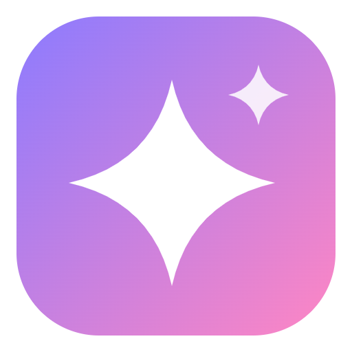
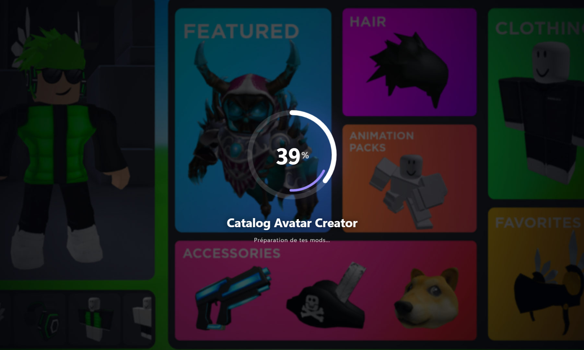
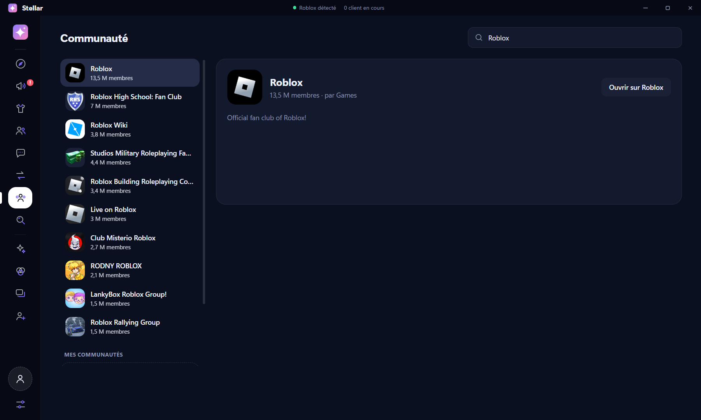
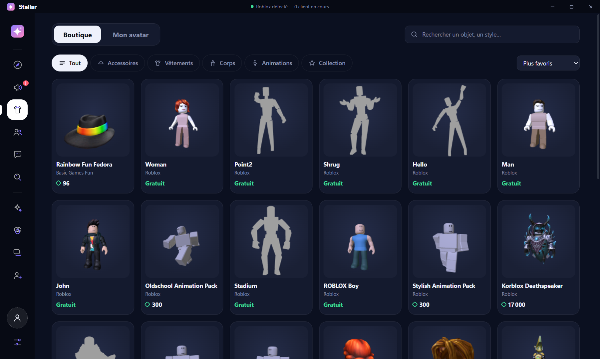
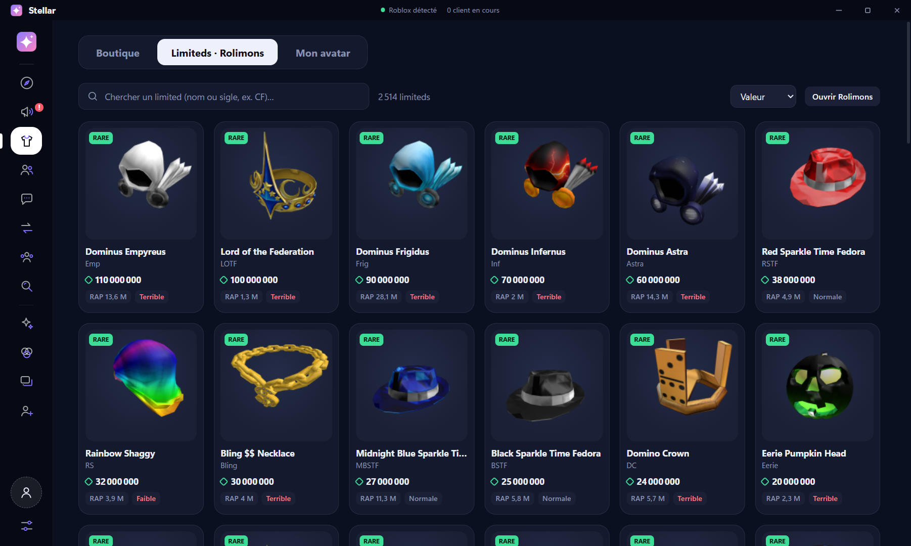
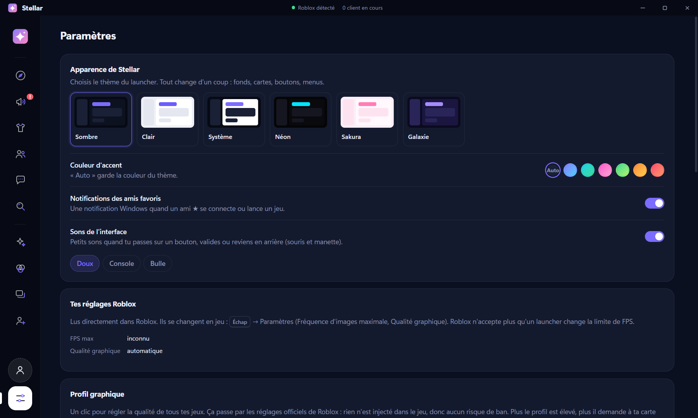
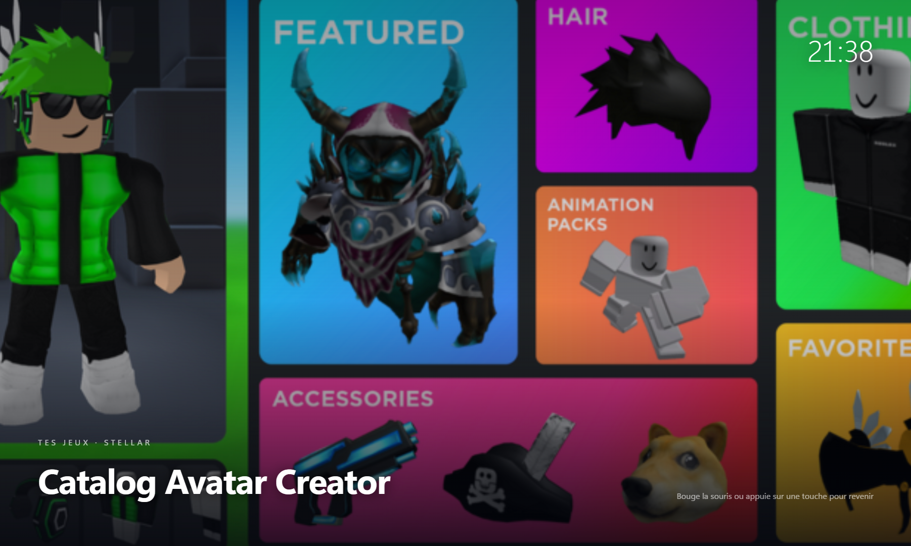

<div align="center">



# Stellar

**Le launcher Roblox façon console.**
Joue, discute, personnalise et pilote tout à la souris, au clavier ou à la manette.


[Télécharger](#-installation) · [Fonctionnalités](#-fonctionnalités) · [Manette & raccourcis](#-manette-et-raccourcis) · [FAQ](#-faq--dépannage) · [Compiler](#-compiler-depuis-les-sources)



</div>

---

## Sommaire

- [Pourquoi Stellar](#-pourquoi-stellar)
- [Installation](#-installation)
- [Fonctionnalités](#-fonctionnalités)
  - [Accueil façon console](#accueil-façon-console)
  - [Lancement d'un jeu (téléportation)](#lancement-dun-jeu-téléportation)
  - [Comptes Roblox](#comptes-roblox)
  - [Amis, Messages, Communauté](#amis-messages-communauté)
  - [Catalogue, Mon avatar, 3D et Limiteds](#catalogue-mon-avatar-3d-et-limiteds)
  - [Trading](#trading)
  - [Découvrir, Nouveautés, Joueurs](#découvrir-nouveautés-joueurs)
  - [Serveurs et « Rejoindre »](#serveurs-et-rejoindre)
  - [Mods Roblox](#mods-roblox)
  - [Musique](#musique)
  - [Graphismes et filtres](#graphismes-et-filtres)
  - [Instances et multi-instance](#instances-et-multi-instance)
  - [Temps de jeu](#temps-de-jeu)
  - [Apparence, sons et écran de veille](#apparence-sons-et-écran-de-veille)
- [Manette et raccourcis](#-manette-et-raccourcis)
- [Recherche avancée](#-recherche-avancée)
- [Paramètres en détail](#-paramètres-en-détail)
- [Sécurité et confidentialité](#-sécurité-et-confidentialité)
- [FAQ / dépannage](#-faq--dépannage)
- [Compiler depuis les sources](#-compiler-depuis-les-sources)
- [Architecture du projet](#-architecture-du-projet)
- [Services utilisés](#-services-utilisés)
- [Crédits](#-crédits)
- [Soutenir le projet](#-soutenir-le-projet)
- [Avertissement](#-avertissement)

---

## ✨ Pourquoi Stellar

Le site et l'appli Roblox sont faits pour tout le monde. Stellar est fait pour **ceux qui jouent beaucoup** :

- un **accueil comme sur une console** : tes jeux récents en grand, un bouton Jouer, tes amis et ta musique sous les yeux ;
- **tout au même endroit** : amis, chat, catalogue, avatar, trading, communautés, nouveautés ;
- des **mods** (curseurs, roue des emotes, police, sons) appliqués proprement et réversibles ;
- **jouable entièrement à la manette** (PS4, PS5, Xbox), avec curseur libre et bouton « Afficher Stellar » comme sur Steam ;
- **rien n'est injecté dans Roblox** : Stellar ne touche qu'aux réglages et fichiers que Roblox autorise.

---

## 📥 Installation

1. Va dans **[Releases](../../releases/latest)** et télécharge `Stellar Setup x.y.z.exe`.
2. Lance l'installeur. Il s'installe **pour ton utilisateur uniquement**, sans droits administrateur, avec un raccourci sur le Bureau et dans le menu Démarrer.
3. L'exe n'est **pas signé** (un certificat coûte cher) : Windows SmartScreen peut afficher « Windows a protégé votre ordinateur ». Clique sur **Informations complémentaires → Exécuter quand même**.
4. Pour mettre à jour, installe simplement la nouvelle version par-dessus : tes réglages, comptes et mods sont gardés.

**Configuration requise** : Windows 10 ou 11 (64 bits), Roblox installé (le client « Roblox Player »).

---

## 🚀 Fonctionnalités

### Accueil façon console

- **Rangée de jeux** en haut : tes parties récentes (lues dans ton compte Roblox **et** dans les logs de Roblox, donc même les jeux lancés sans Stellar). Le jeu sélectionné grandit et affiche son nom.
- **Grand visuel** du jeu en fond, nom, joueurs en ligne, ton temps de jeu, gros bouton **Jouer** et bouton **···** (détails et serveurs).
- **4 cartes** : amis dans ce jeu (avec « Rejoindre »), ton temps de jeu, choix du serveur, musique en cours.
- **Onglets du haut** *Jeux · Découvrir · Catalogue · Nouveautés* présents sur chacune de ces pages, pour passer de l'une à l'autre directement.
- **Barre de navigation** qui s'ouvre avec les noms au survol (ou avec L1/R1 à la manette), à placer **à gauche, à droite, en haut ou en bas**, et dont tu choisis les boutons.

### Lancement d'un jeu (téléportation)


Quand tu cliques sur **Jouer** :

1. La **bannière du jeu** remplit l'écran avec un léger zoom, et le **son Stellar** se joue.
2. Un **grand cercle** tourne avec le **pourcentage** au centre. Il suit **ce que fait vraiment Roblox**, lu dans ses logs : démarrage, ouverture de la fenêtre, connexion au serveur, téléchargement, chargement.
3. Stellar reste **au-dessus de Roblox** pendant le chargement. Il n'affiche 100 % que lorsque le jeu a fini de charger, c'est-à-dire quand Roblox arrête d'écrire en masse dans son log (10 s maximum).
4. **Plongée** dans la bannière (zoom, flou de vitesse, traînées d'étoiles, fermeture en cercle), puis **Roblox passe devant**.

Le bouton **Passer** apparaît à partir de 50 % (✕/A à la manette). L'animation peut être coupée dans *Paramètres › Launcher*.

### Comptes Roblox

- **Connexion sur la vraie page roblox.com**, dans une fenêtre séparée : Stellar **ne voit jamais ton mot de passe** et garde seulement la session, isolée par compte et stockée uniquement sur ton PC.
- **Plusieurs comptes**, avec changement en un clic et affichage des Robux. Retirer un compte le **déconnecte aussi côté Roblox**.
- Lancement des jeux avec le compte choisi (ticket d'authentification officiel).

### Amis, Messages, Communauté

- **Amis** : en ligne, en jeu (avec le nom du jeu), hors ligne. Tu peux mettre des **favoris ★**, recevoir une **notification Windows** quand un favori se connecte, donner des **surnoms**, trier, retirer des amis, accepter des demandes et **rejoindre** un ami en un clic.
- **Messages** : le **chat Roblox** officiel dans Stellar (conversations, envoi, nouvelle conversation, badge de non-lus). Il respecte les règles de Roblox (âge, vérification, confidentialité).
- **Communauté** : tes communautés Roblox (ex-groupes) avec leur annonce, leur description, leurs jeux, ainsi qu'une recherche de communautés.



### Catalogue, Mon avatar, 3D et Limiteds



- **Boutique** : catégories (Accessoires, Vêtements, Corps, Animations, Collection), tri, recherche, prix. Au survol, un bouton **Essayer** apparaît.
- **Fenêtre objet** : un clic sur un objet ouvre une vue **3D** que tu peux tourner et zoomer, avec son prix, sa valeur Rolimons, **Essayer sur mon avatar** et **Voir sur Roblox**. La 3D demande d'être connecté ; les emotes restent en image.
- **Mon avatar** : crée ton skin avec **tes objets** (chapeaux, cheveux, visages, accessoires, hauts, bas, chaussures), tes **tenues enregistrées** et la **couleur de peau**. Un **aperçu en direct** se met à jour pendant que tu changes, une **vue 3D** montre ton avatar enregistré, et **Enregistrer sur Roblox** applique le tout. « Essayer » marche sur n'importe quel objet de la boutique, mais Roblox n'enregistre que ceux que tu possèdes.
- **Limiteds · Rolimons** : les ~2 500 limiteds avec **RAP, valeur, demande et tendance** (données publiques de Rolimons), recherche par nom ou sigle (ex. `CF`), tri, et un bouton pour ouvrir Rolimons.



### Trading

- Tes échanges **reçus, envoyés, terminés et inactifs**.
- Pour chaque échange : les objets **des deux côtés** avec leur valeur (Rolimons, sinon RAP), et le verdict **« Tu gagnes / tu perds X de valeur »**.
- Tu peux **refuser** depuis Stellar. Pour **accepter**, Stellar t'envoie sur Roblox, qui demande souvent une vérification. C'est volontaire : Stellar n'accepte jamais d'échange à ta place.

### Découvrir, Nouveautés, Joueurs

- **Découvrir** : les classements officiels (Tendances, Populaires, À venir…) et la recherche de jeux.
- **Nouveautés** : les **annonces officielles de Roblox** (DevForum, en anglais), les **jeux qui montent** et les **derniers objets** du catalogue. Un badge apparaît sur le bouton quand Roblox publie quelque chose.
- **Joueurs** : recherche d'un joueur, avec son profil, son avatar et sa présence.

### Serveurs et « Rejoindre »

Dans la fenêtre d'un jeu :

- **⚡ Meilleur ping**, **🍃 Le plus vide**, liste des serveurs publics triable (plus ou moins de joueurs, ping).
- Le champ **Rejoindre** accepte :
  - `@pseudo` ou un **ID joueur** : tu rejoins son serveur, si ses réglages le permettent ;
  - un **ID de serveur** (`xxxxxxxx-xxxx-xxxx-xxxx-xxxxxxxxxxxx`) : tu arrives dans ce serveur précis.

### Mods Roblox

Tous les mods sont appliqués **au lancement**, avec une **sauvegarde des fichiers d'origine**. Chaque mod se retire en un clic, et Stellar réapplique ses mods si Roblox se met à jour.

| Mod | Détails |
|---|---|
| **Curseurs** | Styles prêts à l'emploi, couleur au choix, ou ton image. |
| **Traînée de curseur** | Sakura, étoiles, cœurs, neige, bulles, arc-en-ciel, papillons, avec densité et taille réglables. Affichée par-dessus le jeu. |
| **Roue des emotes** | Thèmes, couleur des traits, opacité, ton image, plus un **éditeur de stickers** (à placer sur ou autour de la roue). |
| **Police** | Liste de polices prêtes, ou **ta propre police** (TTF/OTF). |
| **Son de mort** | Défaut, **« Oof » classique** ou ton son `.ogg`. |
| **Sons du personnage** | Saut, atterrissage, pas, chute, se relever, nage, plouf, explosion : défaut, **muet** ou ton son (MP3/OGG/WAV). |
| **Sons de clavier** | Creamy, thocky, clicky, bulle, machine à écrire, doux, ou ton son, avec volume et option « seulement dans Roblox ». Seul le **type** de touche est utilisé, jamais ce que tu tapes. |

### Musique

- **Lecteur intégré** pour Spotify, Deezer, YouTube dans le navigateur, et toute appli qui s'affiche dans le panneau média de Windows : titre, pochette, lecture/pause, précédent/suivant, volume.
- **Raccourcis clavier globaux** que tu définis toi-même ; ils marchent **même en jeu**.
- **Carte « en cours »** en haut à droite quand la chanson change pendant que tu joues.
- **Lecteur qui reste à l'écran** par-dessus le jeu, déplaçable, avec ses boutons. Il s'ouvre ou se ferme avec un raccourci clavier **ou un bouton de ta manette** (Stellar l'apprend quand tu appuies dessus).

> ⚠️ En **plein écran Roblox (F11)**, Windows cache toutes les autres fenêtres : carte musique, lecteur et traînée ne peuvent pas s'afficher. Joue en **fenêtre agrandie**. Les raccourcis, eux, marchent toujours.

### Graphismes et filtres

- **Profils graphiques** en un clic (Performance, Équilibré, Qualité, Ultra) qui passent par les **réglages autorisés par Roblox** (FastFlags de sa liste autorisée) : qualité, anti-aliasing (MSAA), textures, ombres, effets, herbe.
- **Éditeur de FastFlags** pour les experts (JSON), avec aperçu des flags appliqués.
- **Forcer la carte graphique dédiée** (préférence GPU Windows pour Roblox).
- **Filtres** : raccourci vers les filtres NVIDIA (Alt+Z) et explications.

### Instances et multi-instance

- Liste des **clients Roblox ouverts** (seuls ceux qui ont une vraie fenêtre comptent), avec leur mémoire et un bouton **Fermer** ou **Tout fermer**.
- Les **processus Roblox fantômes** (restes invisibles de jeux fermés) sont affichés à part, avec un bouton **Nettoyer**.
- **Multi-instance** (expérimental) : plusieurs clients en même temps, idéal avec plusieurs comptes.
- **Fermer Roblox quand je quitte une partie** : quitter un jeu ou fermer Roblox (même avec Alt+F4) ramène Stellar à l'écran.

### Temps de jeu

Reconstruit à partir des **logs de Roblox** : chaque partie compte, même lancée sans Stellar. Graphique de la semaine, total du jour, top des jeux, temps par jeu sur l'accueil.

### Apparence, sons et écran de veille



- **Thèmes** : Sombre, Clair, **Système** (suit Windows), Néon, Sakura, Galaxie, avec une couleur d'accent au choix.
- **Sons d'interface** (survol, déplacement, valider, retour, page) en 3 packs : Doux, Console, Bulle.
- **Le son Stellar** : un jingle original, joué au démarrage et au lancement d'un jeu.
- **Musique du menu** : une ambiance douce sur l'accueil, comme un menu de console (désactivée par défaut).
- **Écran de veille** : au bout de *N* minutes (de 1 à 30) sans rien faire sur l'accueil, tes jeux défilent en grand avec l'heure. Tu choisis les jeux montrés (récents, favoris, tendances) et le son. Un bouton **Aperçu** permet de le tester.



---

## 🎮 Manette et raccourcis

Stellar se pilote **entièrement à la manette** (PS4, PS5, Xbox, ou toute manette reconnue par Windows).

| Bouton | Action |
|---|---|
| Croix / stick gauche | Se déplacer (focus visible, sons de déplacement) |
| **✕ / A** | Valider / Passer le chargement |
| **○ / B** | Retour (fermer une fenêtre, revenir à l'accueil) |
| **△ / Y** | Détails du jeu sélectionné |
| **□ / X** | Recherche |
| **L1 / R1** | Parcourir les boutons de la barre (la page s'ouvre quand tu t'arrêtes) |
| **Options / Start** | Paramètres |
| Stick droit | Faire défiler |
| **Share / View** *(modifiable)* | **Curseur libre** : une vraie souris au stick gauche, ✕/A pour cliquer |
| *Bouton au choix* | **Afficher / cacher Stellar**, même en jeu |
| *Bouton au choix* | Ouvrir / fermer le **lecteur de musique** |

| Clavier | Action |
|---|---|
| **Ctrl + Maj + S** *(modifiable)* | Afficher / cacher Stellar, même en jeu |
| **Ctrl + K** | Recherche |
| **Échap** | Fermer une fenêtre |
| *Raccourcis au choix* | Musique : lecture/pause, suivant, précédent, volume, titre en jeu, lecteur |

---

## 🔎 Recherche avancée

La barre de recherche de l'accueil comprend des raccourcis :

| Tape | Résultat |
|---|---|
| `Brookhaven` | Recherche de jeux (normale) |
| `gameid:66654135` | Ouvre le jeu (ID d'univers) |
| `placeid:142823291` | Ouvre le jeu à partir de l'ID de place |
| `@builderman` | Ouvre le profil du joueur |
| `userid:156` | Ouvre le profil du joueur à partir de son ID |
| `join:@pseudo` | Rejoint ce joueur dans son serveur |
| `jobid:ID placeid:123` | Rejoint un serveur précis |

---

## ⚙️ Paramètres en détail

| Section | Réglages |
|---|---|
| **Apparence** | Thème, couleur d'accent, notifications des amis favoris, sons d'interface et pack de sons |
| **Soutenir Stellar** | Lien PayPal |
| **Sons et veille** | Son Stellar (avec « Écouter »), musique du menu, écran de veille (délai, jeux, son, aperçu) |
| **Manette** | Bouton « Afficher Stellar », bouton et vitesse du curseur libre |
| **Barre de navigation** | Position (gauche, droite, haut, bas), boutons affichés |
| **Launcher** | Réduire au lancement, animation de téléportation, fermer Roblox en quittant une partie |
| **Réglages Roblox** | FPS max et qualité lus dans Roblox, profils graphiques, réglages avancés, FastFlags |

---

## 🔒 Sécurité et confidentialité

- **Pas d'injection** : Stellar ne modifie pas le jeu en mémoire et ne contourne pas l'anti-triche. Il écrit seulement des **FastFlags autorisés** et remplace des **fichiers de contenu** (images, sons, polices) dans le dossier de Roblox, en gardant les originaux.
- **Ton mot de passe ne passe jamais par Stellar** : la connexion se fait sur roblox.com dans une fenêtre isolée, et seule la session est gardée, **sur ton PC uniquement**, séparée par compte.
- Les **appels réseau** ne vont qu'aux services de Roblox, à l'API publique de Rolimons (lecture seule), et à paypal.com quand tu cliques sur le bouton de don.
- Les **sons de clavier** n'enregistrent jamais ce que tu tapes : seul le type de touche compte (lettre, espace, entrée…).
- Tes données (config, temps de jeu, mods) sont dans `%APPDATA%\Stellar`.

---

## ❓ FAQ / dépannage

<details>
<summary><b>La carte musique, le lecteur ou la traînée de curseur ne s'affichent pas en jeu</b></summary>

Roblox est en **plein écran exclusif** (F11) : Windows y cache toutes les autres fenêtres. Appuie sur **F11** dans Roblox pour passer en fenêtre agrandie.
</details>

<details>
<summary><b>« Pas de 3D : … »</b></summary>

La 3D demande d'**être connecté**. Le message indique à quelle étape Roblox bloque (« l'API 3D refuse », « description 3D refusée », « fichier du modèle refusé »). Ouvre une *issue* avec ce texte.
</details>

<details>
<summary><b>Des objets sont invisibles en jeu avec un profil élevé</b></summary>

Forcer l'anti-aliasing (MSAA) à **8×** peut empêcher Roblox d'afficher certaines vues 3D, comme les icônes d'objets dans la barre d'inventaire. Le profil Ultra utilise 4×. Si le souci persiste, mets l'anti-aliasing sur **Auto**.
</details>

<details>
<summary><b>Le chat dit qu'il n'est pas disponible</b></summary>

Roblox limite le chat selon l'**âge, la vérification et les paramètres de confidentialité** du compte. Stellar applique les mêmes règles que Roblox.
</details>

<details>
<summary><b>Je ne peux pas rejoindre un joueur</b></summary>

Le joueur a peut-être limité qui peut le rejoindre, ou il n'est pas en jeu (ou cache sa partie). Stellar essaie quand même, mais c'est Roblox qui décide.
</details>

<details>
<summary><b>Le compteur d'instances semble faux</b></summary>

Seules les fenêtres Roblox visibles comptent. Les processus Roblox restés en arrière-plan sont listés à part : utilise **Nettoyer**.
</details>

<details>
<summary><b>Windows SmartScreen bloque l'installeur</b></summary>

L'exe n'est pas signé. Clique sur **Informations complémentaires → Exécuter quand même**.
</details>

<details>
<summary><b>Comment tout remettre comme avant ?</b></summary>

Dans *Mods*, remets chaque mod sur « Défaut » / « Réinitialiser » : les fichiers d'origine sont restaurés. Pour repartir de zéro, désinstalle Stellar et supprime `%APPDATA%\Stellar`.
</details>

---

## 🛠 Compiler depuis les sources

Prérequis : **Node.js 20+** et **Windows**.

```powershell
git clone https://github.com/exiozz/stellar-launcher.git
cd stellar-launcher
npm install
npm start          # lance Stellar en mode développement
npm run dist       # crée dist\Stellar Setup <version>.exe
```

`npm start` et `npm run dist` réinstallent eux-mêmes les dépendances si `node_modules` manque (`scripts/ensure-deps.js`). Les modules natifs ne sont pas recompilés (`npmRebuild: false`), donc **pas besoin de Visual Studio**.

---

## 🧭 Architecture du projet

```
main.js              Processus principal Electron : fenêtres, config, IPC, lancement de Roblox,
                     FastFlags, mods, instances, musique, overlays, manette (via media.js), écran de lancement
accounts.js          Connexion roblox.com isolée par compte, client HTTP avec jeton CSRF, ticket de lancement
mods.js              Mods de fichiers : sauvegarde/restauration, curseurs, roue des emotes, police, sons
media.js             Assistant PowerShell : session média Windows (musique) et lecture des manettes (Windows.Gaming.Input)
playtime.js          Temps de jeu reconstruit à partir des logs de Roblox
focus.js             Surveille l'appli au premier plan (sons de clavier « seulement dans Roblox », overlays)
preload.js           Pont sécurisé (contextIsolation) entre l'interface et le processus principal
preload-overlay.js   Pont pour les fenêtres par-dessus le jeu (traînée, carte et lecteur de musique)
renderer/
  index.html, styles.css   Interface et thèmes
  app.js             Cœur de l'interface : accueil, amis, jeux, serveurs, mods, paramètres
  console.js         Accueil console, navigation manette, curseur libre
  extras.js          Barre de navigation, onglets du haut, écran de lancement, veille, ambiance
  chat.js            Messages (chat Roblox)
  news.js            Nouveautés (DevForum, jeux qui montent, catalogue récent)
  avatar.js          Mon avatar (tenues, objets, peau, aperçu, 3D)
  viewer3d.js        Visionneuse 3D (three.js) des objets et avatars Roblox
  itemview.js        Fenêtre objet du catalogue
  rolimons.js        Limiteds et valeurs Rolimons
  social.js          Trading et Communauté
  join.js            Rejoindre par ID/@ et recherche avancée
  sfx.js             Sons d'interface (WebAudio)
  stellar-sound.js   Le jingle Stellar et la musique du menu (WebAudio)
  keysounds.js       Sons de clavier
  fx.js, overlay.*   Traînées de curseur par-dessus le jeu
  music-popup.*      Carte « en cours » en jeu
  music-player.*     Lecteur de musique qui reste à l'écran
  art.js, stickers.js  Curseurs, thèmes de roue, éditeur de stickers
  vendor/            three.js et ses chargeurs (licence MIT incluse)
scripts/ensure-deps.js   Installe les dépendances si besoin
build/icon.png           Icône de l'application
```

Choix techniques :

- **Electron** avec `contextIsolation`, `sandbox` et une **CSP stricte** (scripts locaux uniquement).
- Toutes les requêtes authentifiées passent par le **processus principal**, et seuls les **domaines Roblox** sont autorisés.
- Les sons sont **synthétisés** (WebAudio) : aucun fichier audio n'est livré.
- Les fonctions Windows (média, manettes, fenêtre au premier plan) passent par de **petits assistants PowerShell** qui tournent en continu, sans module natif à compiler.

---

## 🌐 Services utilisés

| Service | Usage |
|---|---|
| `*.roblox.com` (API officielles) | Comptes, amis, présence, jeux, serveurs, catalogue, avatar, chat, échanges, communautés, miniatures |
| `devforum.roblox.com` | Annonces officielles (page Nouveautés) |
| `rolimons.com/itemapi` | Valeurs des limiteds (lecture seule, public) |
| `*.rbxcdn.com` | Images et modèles 3D de Roblox |

---

## 🙏 Crédits

- [Electron](https://www.electronjs.org/) et [electron-builder](https://www.electron.build/)
- [three.js](https://threejs.org/) (MIT) pour la 3D
- [uiohook-napi](https://github.com/SnosMe/uiohook-napi) pour le clavier global des sons de clavier
- [Rolimons](https://www.rolimons.com/) pour les données publiques des limiteds
- Conçu et développé par **exiozz**

---

## 💜 Soutenir le projet

Stellar est **gratuit**. S'il te plaît, tu peux soutenir son créateur avec un petit don :

**[paypal.me/Tomokari35](https://www.paypal.com/paypalme/Tomokari35)**

Le bouton est aussi dans *Paramètres › Soutenir Stellar*.

---

## ⚠️ Avertissement

Stellar est un projet **indépendant**, **non affilié, ni approuvé, ni sponsorisé par Roblox Corporation**. « Roblox » et les contenus associés sont des marques de Roblox Corporation. Utilise Stellar dans le respect des [Conditions d'utilisation de Roblox](https://en.help.roblox.com/hc/articles/115004647846).
